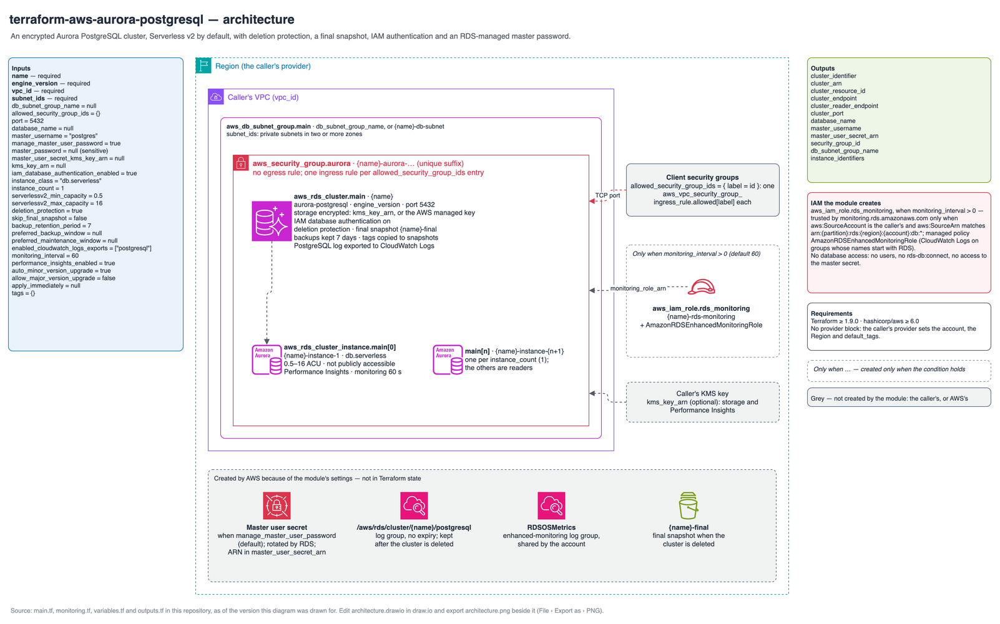

# Reference: names, tags and IAM

Every resource the module can create, when it is created, and the names it gets.
`<name>` is `var.name`; `<n>` counts from 1. Every resource also gets `var.tags`; a
`Name` key in `var.tags` overrides the generated `Name` tag on every resource.

## Diagram

Source: [`architecture.drawio`](architecture.drawio).

## Resources

| Resource | Created when | Name or `Name` tag |
| --- | --- | --- |
| `aws_db_subnet_group.main` | Always | `db_subnet_group_name`, or `<name>-db-subnet` when that is null; tag `<group name>-group`. No description is set, so AWS shows "Managed by Terraform" |
| `aws_security_group.aurora` | Always | Name prefix `<name>-aurora-` (AWS appends a unique suffix); tag `<name>-aurora-sg`; description `Security group for Aurora PostgreSQL cluster`. No rules: the provider removes the allow-all egress rule AWS adds to a new group |
| `aws_vpc_security_group_ingress_rule.allowed["<label>"]` | One per `allowed_security_group_ids` entry | Description `PostgreSQL from <label>`; TCP on `port` from that group (tags: `var.tags` only) |
| `aws_rds_cluster.main` | Always | Identifier `<name>`; tag `<name>-aurora-cluster`; final snapshot `<name>-final` unless `skip_final_snapshot` |
| `aws_rds_cluster_instance.main[<n - 1>]` | One per `instance_count` | Identifier `<name>-instance-<n>`; tag `<name>-aurora-instance-<n>` |
| `aws_iam_role.rds_monitoring[0]` | `monitoring_interval` > 0 | Role `<name>-rds-monitoring` (tags: `var.tags` only) |
| `aws_iam_role_policy_attachment.rds_monitoring[0]` | `monitoring_interval` > 0 | — |
| `data.aws_partition.current[0]` | `monitoring_interval` > 0 | Lookup only, for the managed policy ARN |

Changing `name`, `database_name`, `master_username`, `kms_key_arn` or
`db_subnet_group_name` replaces the cluster. Changing the security group's
description would replace the group, which is why it is fixed.

## Created by AWS, not by Terraform

These exist because of the module's settings but are not in Terraform state, and
some outlive the cluster.

| Object | Created when | Name |
| --- | --- | --- |
| Secrets Manager secret with the master user's credentials | `manage_master_user_password` (default) | Chosen by RDS (`rds!cluster-<id>`); ARN in the `master_user_secret_arn` output; rotated by RDS |
| CloudWatch log groups | One per `enabled_cloudwatch_logs_exports` entry | `/aws/rds/cluster/<name>/<type>`, no expiry; kept after the cluster is deleted |
| Enhanced-monitoring log group | `monitoring_interval` > 0 | `RDSOSMetrics`, shared by every instance in the account and Region |
| Final snapshot | The cluster is deleted and `skip_final_snapshot` is false | `<name>-final`; kept until you delete it |
| Automated backups | Always | Kept `backup_retention_period` days |

## IAM granted by the module

The enhanced-monitoring role is the only IAM the module creates.

| | |
| --- | --- |
| Trusted principal | `monitoring.rds.amazonaws.com`, only when `aws:SourceAccount` is the caller's account and `aws:SourceArn` matches `arn:<partition>:rds:<region>:<account>:db:*` |
| Policy | The AWS managed policy `arn:<partition>:iam::aws:policy/service-role/AmazonRDSEnhancedMonitoringRole`: CloudWatch Logs actions on log groups whose names start with `RDS` |

The module grants no database access: it creates no database user, no
`rds-db:connect` permission and no access to the master password secret.

## Permissions the caller needs

To apply the module, the caller's credentials need:

- **RDS**: create, modify, describe and delete DB clusters, DB instances and DB
  subnet groups; create DB cluster snapshots (for the final snapshot); add, remove
  and list tags. The first RDS resource in an account also needs
  `iam:CreateServiceLinkedRole` for the RDS service-linked role.
- **EC2**: create, describe and delete security groups; authorise and revoke
  ingress rules; revoke egress rules (the default rule); create tags; describe VPCs
  and subnets.
- **IAM**, for the monitoring role: create, read, tag and delete the role; attach
  and detach the managed policy; list its policies and instance profiles; and
  `iam:PassRole` on it, because RDS is given the role when an instance is created;
  and `sts:GetCallerIdentity` to fill in the trust policy's conditions.
- **Secrets Manager**, when RDS manages the password: the permissions RDS uses on the
  caller's behalf to create, tag, rotate and delete the secret
  (`secretsmanager:CreateSecret`, `secretsmanager:TagResource`,
  `secretsmanager:RotateSecret`, `secretsmanager:DescribeSecret`,
  `secretsmanager:UpdateSecret`, `secretsmanager:DeleteSecret`), and `kms:Decrypt`
  and `kms:GenerateDataKey` on `master_user_secret_kms_key_arn` when it is set. AWS
  lists them under "Password management with Amazon RDS and AWS Secrets Manager".
- **KMS**, when `kms_key_arn` is set: `kms:CreateGrant` and `kms:DescribeKey` on the
  key.

## Requirements

| | Minimum | Why |
| --- | --- | --- |
| Terraform | 1.9.0 | Variable validations that refer to other variables |
| `hashicorp/aws` | 6.0 | Every argument the module sets exists in 6.0; `terraform test` passes with the provider pinned to 6.0.0 |

Inputs and outputs are listed in the [README](../../README.md#inputs).
